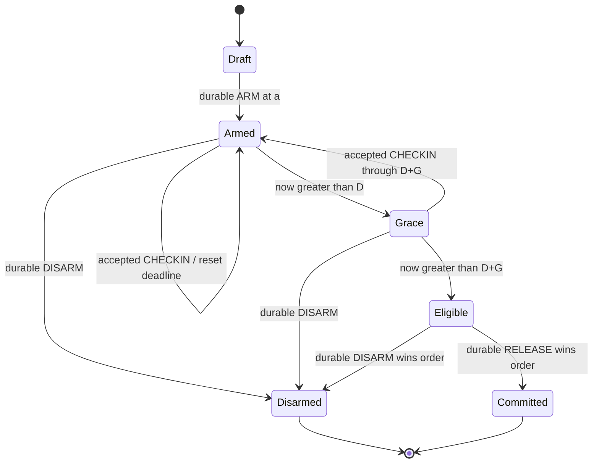

# Lifecycle and finality

Release status: Solo v0.1 as specified by `0.1-draft.2`, included in `v0.1.0-alpha.1`. See [SPEC](../SPEC.md). Historical design/approval notes below are rationale; they add no build or runtime dependency.
Normative alpha lifecycle. Object fields are in [the profile](SOLO-PROFILE-PROPOSAL.md); this document supplies transition semantics.

## Facts and projections

Persisted protocol facts are the immutable signed descriptor, ciphertext and verified key custody, creator commands, signed committed events, authoritative head and accepted-request mapping. The storage implementation must preserve them atomically or recover to an unambiguous committed prefix. Receipt caching and delivery job flags are not new sources of authority.

`DRAFT` is local client state. An accepted ARM creates the first authoritative fact. `ARMED`, `GRACE` and `ELIGIBLE` are derived from the latest ARM/CHECKIN and an explicit trusted evaluation time. They are not irreversible journal entries. `DISARMED` and `COMMITTED` are persisted terminal facts. There is no window-finalization operation in Solo.

For latest accepted renewal at `a`, set `D=a+I`, `E=D+G`, using checked integer arithmetic. With a trusted time `t >= a`:

| Condition | Derived state | CHECKIN | DISARM | RELEASE |
|---|---|---|---|---|
| `t <= D` | ARMED | Accept if head/signature valid | Accept | Reject |
| `D < t <= E` | GRACE | Accept if head/signature valid | Accept | Reject |
| `t > E` | ELIGIBLE | Reject as late | Accept until commitment | May commit |

The interval starts at acceptance, not at the creator's claimed time or intended schedule. A check-in at `E` wins if durably ordered there and renews from that acceptance time. Release first becomes eligible at `E+1`, since precision is whole seconds. No grace interpolation, calendar recurrence, time zone conversion or historical endpoint inference is involved. Accepted check-ins within the same second are still separate head-bound operations and can share a deadline.

Example: `I=60`, `G=10`, ARM at 1000 gives D=1060, E=1070. A check-in accepted at 1070 moves D to 1130 and E to 1140. Without that check-in, evaluation at 1071 is eligible. A disarm durably accepted at 1075 still cancels if RELEASE has not committed. These numbers illustrate arithmetic; they are not cryptographic vectors.

## Acceptance and client certainty

1. Locally signing a command establishes creator intent only.
2. Transmission and HTTP receipt establish no custody fact.
3. Validation inside an unfinished transaction remains provisional.
4. The durable atomic append establishes acceptance and changes the authoritative lease or terminal state.
5. A verified signed event proves the custodian attested to that acceptance.
6. Retaining that event gives the creator an independent historical anchor.

A trusted client may show “check-in accepted” only after verifying the receipt's complete scope, signature, matching request and valid prefix, then retaining the receipt and required history locally. A lost reply produces “unconfirmed—recover receipt”, not success or definitive failure. The accepted participation remains effective even when its receipt was never delivered. Retry the **same envelope** to recover the same bytes; inspection can also recover the committed prefix. Failed local receipt storage does not roll back custodian acceptance.

An unsigned success boolean, network acknowledgement, local timestamp, product database row or scheduler result never establishes acceptance. A lost response to DISARM or RELEASE is likewise uncertain until its committed proof is recovered. Never tell a human that pressing cancel guarantees winning a concurrent release.

## The release/disarm race

The custodian provides one durable total order per Capsule. For each attempted mutation it atomically reads the current prefix, revalidates the request and time, checks terminal state and idempotency, and appends at most one event. Release eligibility calculated outside that boundary is advisory. A concurrent accepted check-in changes the head and deadline; a worker must recompute against that new prefix.

DISARM and RELEASE are mutually exclusive terminal appends. The first durable append wins. No event can follow it. Network arrival, request signing, thread start, read snapshot, tentative signature, notification and ciphertext download are not the ordering boundary. A worker must not export a precomputed sealed key before committing its matching RELEASE event. Retrying RELEASE returns the stored archive/material, not a new release box or event.

The policy predicate becomes true at eligibility. Final authorization occurs only with a valid durable RELEASE append. That append is also irreversible protocol commitment. Exporting the release archive is a later disclosure-capability transfer. Recipient decryption is later still. Successful recipient download or decryption is not required for commitment, and cannot restore disarm authority. Actual reading cannot be proved by a server delivery flag. The custodian may have learned plaintext at activation; “disclosure” here means the authorized recipient release path, not absence of earlier custodian access.

Historical deadline passage never freezes cancellation. There is no `FINAL` marker that blocks DISARM merely because a past observation window closed. The 0.7 attack V motivates this rule; 0.8's separation of eligibility from terminal commitment is retained without its consensus machinery.

## Authoritative time

Time is nonnegative POSIX/Unix seconds, rounded down from the custodian's trusted UTC source. Leap seconds and local DST do not introduce additional wire values. The source's UTC interpretation and any leap smear must be documented operationally. Creator/browser/recipient clocks and HTTP `Date` headers are not acceptance authority. All additions must remain in the codec's safe-integer range; overflow causes rejection, never wraparound.

The custodian must provide a health-qualified clock. While a process is running, it compares UTC progress against a monotonic source on each mutation/evaluation; a discrepancy over five seconds or any backward UTC step latches the clock unhealthy. Smaller adjustments must still preserve nondecreasing recorded time. This detects some faults, not coordinated clock manipulation or gradual inaccurate drift. The protocol's durations are durations of its stated custodian clock, not an independent proof of elapsed physical time.

Unhealthy/unknown time blocks ARM, CHECKIN, RELEASE and current eligibility assertions. Authenticated DISARM remains available with `clock=held` and the preceding event time, because cancellation needs order, not an elapsed-time assertion. Historical reads and duplicate receipt recovery remain available. Unavailable time must never be presented as a current healthy timestamp.

After restart, a persisted last timestamp alone is insufficient: the service must re-establish trusted current UTC and durable head/key continuity before time-dependent mutations. Clock revalidation is an operational trust assumption, **not an administrator command to erase history, change deadlines or override terminal state**. The custodian must document its time source and revalidation procedure. If trusted time cannot be re-established, release can remain unavailable indefinitely; the model supplies no time oracle or forced repair. A valid elapsed gap across downtime may legitimately make a Capsule eligible when trusted time returns. An ordinary process pause does not stop the lease.

Test implementations inject a deterministic clock with the same integer/health rules. A fault-injection clock must be isolated from any non-test service and cannot be reachable through a product endpoint. Signed historical event times establish the custodian's claims at signing, not present freshness or objective UTC.

## Recovery and expiration

A restart must retain accepted IDs, exact receipt bytes, ciphertext, DEK, terminal boxes and the committed head. Before-commit crashes leave no accepted operation; after-commit crashes recover the accepted operation even without its reply. All-or-nothing key/payload custody may use staged immutable files plus a committed manifest, but no acknowledged event may depend on an orphaned file. Power-loss durability must be separately tested against the provider's advertised boundary.

Restoring an old backup does not create a new legitimate history. Compare against all independently retained anchors; a mismatch means conflict and no release. With no surviving independent anchors, a fully rolled-back custodian cannot cryptographically establish that nothing was lost. If it knows its continuity is uncertain, it must refuse new release; there is no privileged reset that blesses a missing prefix. All-device/all-backup loss may prevent recovery permanently.

There is no contract end date, automatic policy amendment, terminal re-arm or key rotation within one Capsule. Grace expiry is a release predicate, not proof expiry and not a loss of disarm authority. A receipt does not expire as historical evidence. Its use as a claim of *current* status requires fresh inspection. A signed CHECKIN is valid only against its exact current basis and through grace; accepted duplicates remain valid historical receipts forever. Recipient/creator/custodian key replacement requires old-Capsule disarm and a new Capsule; loss or compromise may make this unavailable.

Delivery retries may be at least once; the same ciphertext, sealed key and terminal proof must be used. “Exactly once human disclosure”, erasure of leaked keys and recall of exported packages are not supported guarantees.

## Approved recovery and capacity obligations

Terminal RELEASE and its exact canonical archive/ciphertext must be persisted in one recoverable atomic operation. An implementation may use one transactional BLOB, or another storage discipline with equivalent crash evidence; a committed terminal flag pointing at an uncommitted file is insufficient. Crashing after tentative event persistence but before archive persistence must leave no committed RELEASE. Crashing after commit but before any response must recover the original archive. Repeated export, including after restart, is byte-identical and has no lifecycle side effects. Lost export responses never undo commitment and never imply successful delivery.

For every nonterminal verified prefix, report ordinary CHECKIN capacity `9999-head.seq`; warn at <=100, including a mandatory exhaustion warning at zero. At sequence 9999, reject new CHECKIN with CAPACITY and leave the existing deadline untouched. Duplicate receipt recovery, inspect, disarm and policy evaluation remain available. Sequence 10000 can hold only a terminal event. Before elapsed grace, full capacity still cannot authorize release; after elapsed grace the existing instruction may authorize it. No automatic extra grace, indefinite renewal promise or implicit disclosure-on-full rule exists. Migration requires separately disarming the old Capsule and creating another; a new Capsule does not cancel the old one.
